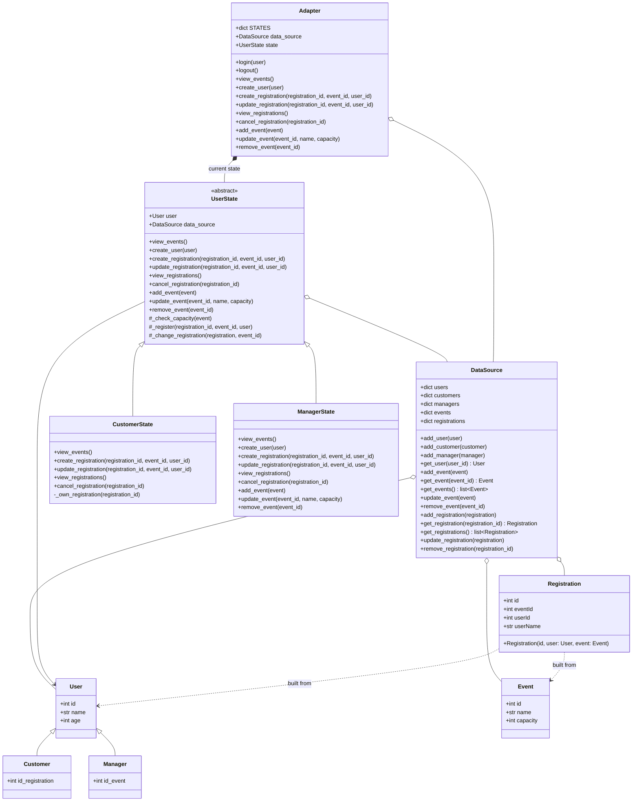

# UNIBZ_M2_CI_PROJECT

- **Project:** UNIBZ Continuous Integration
- **Student:** Pedro David Ramos Salamanca

Event registration system with two user roles, **Customer** and **Manager**. Access control is implemented with the **State** design pattern: the `Adapter` delegates every action to a role-specific state object, which either performs it on the `DataSource` or raises `PermissionError`.

## Class diagram



## Behaviour

`Adapter.login(user)` picks the state from the user's type (`Customer` → `CustomerState`, `Manager` → `ManagerState`). Every call is forwarded to that state. Without a logged-in user, any call raises `PermissionError("No user logged in")`.

| Action | Customer | Manager |
|---|---|---|
| View events | ✅ | ✅ |
| Add / update / remove events | ❌ | ✅ |
| Create users | ❌ | ✅ |
| Create registration | ✅ (only for themselves) | ✅ (for any user) |
| Update registration | ✅ (only their own) | ✅ (any) |
| View / cancel registrations | ✅ (only their own) | ✅ (any) |

Creating a registration, or moving it to a different event, raises `ValueError` if the event is already full (`capacity`).

## Usage

```python
from DataSource import DataSource
from Adapter import Adapter
from Customer import Customer
from Manager import Manager
from Event import Event

data_source = DataSource()
manager = Manager(1, "Luis", 40, 0)
customer = Customer(2, "Ana", 30, 0)
data_source.add_manager(manager)
data_source.add_customer(customer)

adapter = Adapter(data_source)

adapter.login(manager)
adapter.add_event(Event(1, "Concert", 100))
adapter.create_registration(1, 1, user_id=customer.id)

adapter.login(customer)
print([event.name for event in adapter.view_events()])
print([registration.id for registration in adapter.view_registrations()])
adapter.cancel_registration(1)
```

## Command line

`eventsHolidays.py` runs the project from the terminal. Data is stored in `data.json` and the current user in `session.json` (both git-ignored; set `EVENTS_DATA_DIR` to store them elsewhere).

```
$ python3 eventsHolidays.py --help
Usage: eventsHolidays.py COMMAND [OPTIONS]
Commands:
  login --role {manager,customer} --name NAME [--age N]
  whoami
  logout
  event list
  event add --name NAME --capacity NUMBER
  event update ID [--name NAME] [--capacity NUMBER]
  event remove ID
  event search --available-places NUMBER
  registration list
  registration create --event ID --attendee NAME
  registration change ID [--attendee NAME]
  registration cancel ID
```

`login` selects the role (and creates the user if it does not exist). When a manager uses an `--attendee` name that does not exist yet, a new customer is created.

```
$ python3 eventsHolidays.py login --role manager --name Luis
Logged in as Manager Luis (id 1)
$ python3 eventsHolidays.py event add --name Concert --capacity 40
Event 1 created
$ python3 eventsHolidays.py registration create --event 1 --attendee Ana
Registration 1 created
$ python3 eventsHolidays.py registration list
[1] event 1 - Ana (user 2)
```

### Full walkthrough

Every command of the script, starting from empty data.

**As a manager**

```
$ python3 eventsHolidays.py login --role manager --name Luis --age 40
Logged in as Manager Luis (id 1)
$ python3 eventsHolidays.py whoami
Manager Luis (id 1)
$ python3 eventsHolidays.py event add --name Concert --capacity 40
Event 1 created
$ python3 eventsHolidays.py event add --name Theatre --capacity 20
Event 2 created
$ python3 eventsHolidays.py event add --name Workshop --capacity 60
Event 3 created
$ python3 eventsHolidays.py event list
[1] Concert - capacity 40, available 40
[2] Theatre - capacity 20, available 20
[3] Workshop - capacity 60, available 60
$ python3 eventsHolidays.py event update 1 --name "Summer Concert"
Event 1 updated
$ python3 eventsHolidays.py event update 2 --capacity 30
Event 2 updated
$ python3 eventsHolidays.py event remove 3
Event 3 removed
$ python3 eventsHolidays.py registration create --event 1 --attendee Ana
Registration 1 created
$ python3 eventsHolidays.py registration create --event 2 --attendee Marco
Registration 2 created
$ python3 eventsHolidays.py registration list
[1] event 1 - Ana (user 2)
[2] event 2 - Marco (user 3)
$ python3 eventsHolidays.py registration change 2 --attendee Eva
Registration 2 updated
$ python3 eventsHolidays.py registration cancel 1
Registration 1 cancelled
$ python3 eventsHolidays.py event search --available-places 30
[1] Summer Concert - capacity 40, available 40
$ python3 eventsHolidays.py logout
Logged out
```

**As a customer**

```
$ python3 eventsHolidays.py login --role customer --name Eva
Logged in as Customer Eva (id 4)
$ python3 eventsHolidays.py event list
[1] Summer Concert - capacity 40, available 40
[2] Theatre - capacity 30, available 29
$ python3 eventsHolidays.py event search --available-places 1
[1] Summer Concert - capacity 40, available 40
[2] Theatre - capacity 30, available 29
$ python3 eventsHolidays.py registration list
[2] event 2 - Eva (user 4)
$ python3 eventsHolidays.py registration create --event 1 --attendee Eva
Registration 3 created
$ python3 eventsHolidays.py registration cancel 2
Registration 2 cancelled
$ python3 eventsHolidays.py registration list
[3] event 1 - Eva (user 4)
$ python3 eventsHolidays.py event add --name Party --capacity 20
Error: Customer cannot add events
$ python3 eventsHolidays.py logout
Logged out
$ python3 eventsHolidays.py whoami
No user logged in
```
