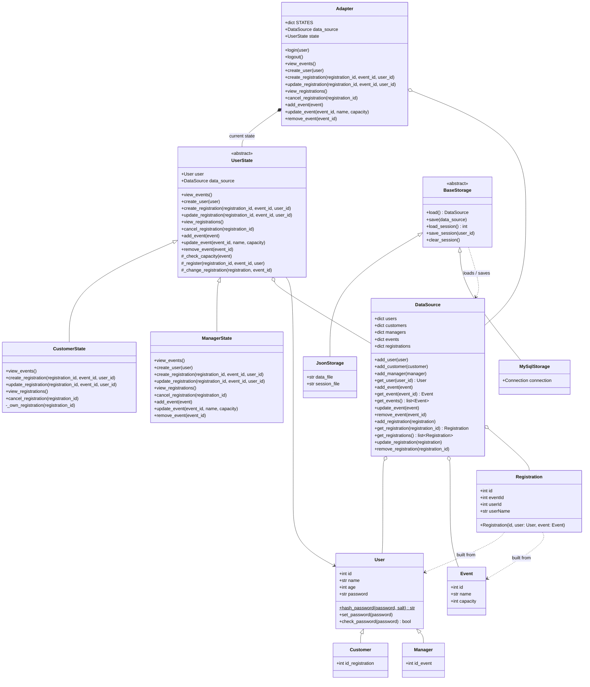
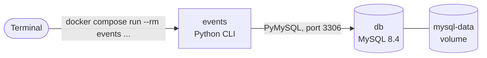

# UNIBZ_M2_CI_PROJECT

- **Project:** UNIBZ Continuous Integration
- **Student:** Pedro David Ramos Salamanca

Event registration system with two user roles, **Customer** and **Manager**. Access control is implemented with the **State** design pattern: the `Adapter` delegates every action to a role-specific state object, which either performs it on the `DataSource` or raises `PermissionError`.

## Quick start

All commands run from the project folder of a fresh checkout. The web app is served at **http://localhost:8000**.

| Address | What it is |
|---|---|
| http://localhost:8000 | Web app (log in, events, registrations) |
| http://localhost:8000/docs | Interactive API documentation (Swagger UI) |
| http://localhost:8000/openapi.yaml | OpenAPI specification |

### Option A: Docker Compose (MySQL, recommended)

Requires Docker with Compose v2.

```
cp .env.example .env
docker compose up -d --build --wait api
```

Open http://localhost:8000. `--wait` returns once the database and the API are healthy.

Use the CLI against the same database:

```
docker compose run --rm events login --role manager --name Luis --password luis123
docker compose run --rm events event list
```

Stop:

```
docker compose down       # stops the app, KEEPS the data (volume <project>_mysql-data)
docker compose down -v    # stops the app and DELETES the database volume
```

The MySQL data lives in a named Docker volume (`docker volume ls` shows it as `<project>_mysql-data`, e.g. `unibz_m2_ci_project_mysql-data`), so it survives `down`/`up` and image rebuilds. To use other ports, change `API_HOST_PORT` / `DB_HOST_PORT` in `.env`.

### Option B: Local Python (JSON files, no Docker)

Requires Python 3.12+.

```
python3 -m venv .venv
source .venv/bin/activate
pip install -r requirements.txt
python api.py
```

Open http://localhost:8000. Stop with `Ctrl+C`. Data is stored in `data.json` in the project folder (delete it to start fresh).

### Run the tests

```
python3 -m venv .venv
source .venv/bin/activate
pip install -r requirements.txt -r requirements-dev.txt
pytest -q
openapi-spec-validator openapi.yaml
```

- `tests/test_rules.py`: unit tests of the application rules (passwords, login/sign-up, capacity, manager and customer permissions, removing events, JSON storage).
- `tests/test_api.py`: REST API tests (URLs, methods, status codes, errors) and OpenAPI validation.

## Class diagram



`create_storage()` in `Storage/StorageFactory.py` returns `MySqlStorage` when `DB_HOST` is set, otherwise `JsonStorage`.

## Behaviour

`Adapter.login(user)` picks the state from the user's type (`Customer` → `CustomerState`, `Manager` → `ManagerState`). Every call is forwarded to that state. Without a logged-in user, any call raises `PermissionError("No user logged in")`.

| Action | Customer | Manager |
|---|---|---|
| View events | ✅ | ✅ |
| Add / update / remove events | ❌ | ✅ |
| Create users | ❌ | ✅ |
| Create registration | ✅ (only for themselves) | ✅ (for any user) |
| Update registration | ✅ (only their own) | ✅ (any) |
| View / cancel registrations | ✅ (only their own) | ✅ (any) |

Creating a registration, or moving it to a different event, raises `ValueError` if the event is already full (`capacity`).

## Usage

```python
from DataSource import DataSource
from Adapter import Adapter
from Customer import Customer
from Manager import Manager
from Event import Event

data_source = DataSource()
manager = Manager(1, "Luis", 40, 0)
customer = Customer(2, "Ana", 30, 0)
data_source.add_manager(manager)
data_source.add_customer(customer)

adapter = Adapter(data_source)

adapter.login(manager)
adapter.add_event(Event(1, "Concert", 100))
adapter.create_registration(1, 1, user_id=customer.id)

adapter.login(customer)
print([event.name for event in adapter.view_events()])
print([registration.id for registration in adapter.view_registrations()])
adapter.cancel_registration(1)
```

## Command line

`eventsHolidays.py` runs the project from the terminal. Run locally, data is stored in `data.json` and the current user in `session.json` (both git-ignored; set `EVENTS_DATA_DIR` to store them elsewhere). With Docker, data is stored in MySQL (see [Docker](#docker)).

```
$ python3 eventsHolidays.py --help
Usage: eventsHolidays.py COMMAND [OPTIONS]
Commands:
  login --role {manager,customer} --name NAME --password PASSWORD [--age N]
  whoami
  logout
  event list
  event add --name NAME --capacity NUMBER
  event update ID [--name NAME] [--capacity NUMBER]
  event remove ID
  event search --available-places NUMBER
  registration list
  registration create --event ID --attendee NAME
  registration change ID [--attendee NAME]
  registration cancel ID
```

`login` selects the role, creates the user if it does not exist, and checks the password (see [Passwords](#passwords)). When a manager uses an `--attendee` name that does not exist yet, a new customer is created.

```
$ python3 eventsHolidays.py login --role manager --name Luis --password luis123
Logged in as Manager Luis (id 1)
$ python3 eventsHolidays.py event add --name Concert --capacity 40
Event 1 created
$ python3 eventsHolidays.py registration create --event 1 --attendee Ana
Registration 1 created
$ python3 eventsHolidays.py registration list
[1] event 1 - Ana (user 2)
```

### Passwords

`User.password` never holds the plain password. It is stored as `salt$hash`, where `hash = SHA-256(salt + password)` and `salt` is a random 16-byte value per user:

```
a427d473477efa65a2f8abb38493d89c$e2222e7efa7d7ace98dff89bc5a947dcfd0590a8718c63b71e326910edc7b299
└──────────── salt ────────────┘ └────────────────────── SHA-256 (64 hex) ──────────────────────┘
```

- Two users with the same password get different hashes, because the salt is different.
- `check_password()` hashes the given password with the stored salt and compares the result with `hmac.compare_digest` (constant-time comparison).
- `login` with a wrong password prints `Error: Invalid password` and does not change the session.
- A user created without a password (a customer created by a manager with `--attendee`) sets the password the first time they log in.

```
$ python3 eventsHolidays.py login --role customer --name Ana --password ana123
Logged in as Customer Ana (id 2)
$ python3 eventsHolidays.py login --role customer --name Ana --password wrong
Error: Invalid password
```

### Full walkthrough

Every command of the script, starting from empty data.

**As a manager**

```
$ python3 eventsHolidays.py login --role manager --name Luis --age 40 --password luis123
Logged in as Manager Luis (id 1)
$ python3 eventsHolidays.py whoami
Manager Luis (id 1)
$ python3 eventsHolidays.py event add --name Concert --capacity 40
Event 1 created
$ python3 eventsHolidays.py event add --name Theatre --capacity 20
Event 2 created
$ python3 eventsHolidays.py event add --name Workshop --capacity 60
Event 3 created
$ python3 eventsHolidays.py event list
[1] Concert - capacity 40, available 40
[2] Theatre - capacity 20, available 20
[3] Workshop - capacity 60, available 60
$ python3 eventsHolidays.py event update 1 --name "Summer Concert"
Event 1 updated
$ python3 eventsHolidays.py event update 2 --capacity 30
Event 2 updated
$ python3 eventsHolidays.py event remove 3
Event 3 removed
$ python3 eventsHolidays.py registration create --event 1 --attendee Ana
Registration 1 created
$ python3 eventsHolidays.py registration create --event 2 --attendee Marco
Registration 2 created
$ python3 eventsHolidays.py registration list
[1] event 1 - Ana (user 2)
[2] event 2 - Marco (user 3)
$ python3 eventsHolidays.py registration change 2 --attendee Eva
Registration 2 updated
$ python3 eventsHolidays.py registration cancel 1
Registration 1 cancelled
$ python3 eventsHolidays.py event search --available-places 30
[1] Summer Concert - capacity 40, available 40
$ python3 eventsHolidays.py logout
Logged out
```

**As a customer**

```
$ python3 eventsHolidays.py login --role customer --name Eva --password eva123
Logged in as Customer Eva (id 4)
$ python3 eventsHolidays.py event list
[1] Summer Concert - capacity 40, available 40
[2] Theatre - capacity 30, available 29
$ python3 eventsHolidays.py event search --available-places 1
[1] Summer Concert - capacity 40, available 40
[2] Theatre - capacity 30, available 29
$ python3 eventsHolidays.py registration list
[2] event 2 - Eva (user 4)
$ python3 eventsHolidays.py registration create --event 1 --attendee Eva
Registration 3 created
$ python3 eventsHolidays.py registration cancel 2
Registration 2 cancelled
$ python3 eventsHolidays.py registration list
[3] event 1 - Eva (user 4)
$ python3 eventsHolidays.py event add --name Party --capacity 20
Error: Customer cannot add events
$ python3 eventsHolidays.py logout
Logged out
$ python3 eventsHolidays.py whoami
No user logged in
```

## REST API and web form

[api.py](api.py) exposes the same use cases as the CLI as a resource-oriented REST API (Flask). It reuses `Adapter`, the user states and the storage layer, so the role rules are identical. The full contract (endpoints, parameters, schemas, examples and errors) is in [openapi.yaml](openapi.yaml) (OpenAPI 3.1).

```
pip install -r requirements.txt
python api.py                 # http://localhost:8000
```

| URL | Content |
|---|---|
| `/` | Web form: log in, manage events and registrations |
| `/docs` | Swagger UI for the API |
| `/openapi.yaml` | OpenAPI specification |

| Method | URL | Success | Errors |
|---|---|---|---|
| POST | `/api/v1/sessions` | 201 | 400, 401 |
| DELETE | `/api/v1/sessions/current` | 204 | 401 |
| GET | `/api/v1/users/me` | 200 | 401 |
| GET | `/api/v1/events?minAvailablePlaces=N` | 200 | 400, 401 |
| POST | `/api/v1/events` | 201 + `Location` | 400, 401, 403 |
| GET / PATCH / DELETE | `/api/v1/events/{id}` | 200 / 200 / 204 | 400, 401, 403, 404 |
| GET | `/api/v1/registrations` | 200 | 401 |
| POST | `/api/v1/registrations` | 201 + `Location` | 400, 401, 403, 404, 409 |
| GET / PATCH / DELETE | `/api/v1/registrations/{id}` | 200 / 200 / 204 | 400, 401, 403, 404, 409 |

Errors always have the body `{"error": {"code": "...", "message": "..."}}`. `409 event_full` means the event has no places left.

```
TOKEN=$(curl -s -X POST localhost:8000/api/v1/sessions -H 'Content-Type: application/json' \
  -d '{"role":"manager","name":"Luis","password":"luis123"}' | python3 -c 'import sys,json;print(json.load(sys.stdin)["token"])')
curl -s -X POST localhost:8000/api/v1/events -H "Authorization: Bearer $TOKEN" \
  -H 'Content-Type: application/json' -d '{"name":"Concert","capacity":40}'
curl -s localhost:8000/api/v1/events -H "Authorization: Bearer $TOKEN"
```

With Docker: `docker compose up -d api` (port `API_HOST_PORT`, default 8000; set `API_SECRET_KEY` in `.env`).

Tests: `pip install -r requirements-dev.txt && pytest -q tests`.

## Docker

The project runs with Docker Compose as two containers:



| Service | Image | Purpose |
|---|---|---|
| `events` | `events-holidays:latest` (built from the `Dockerfile`) | Runs `eventsHolidays.py`. A new container is started for every command. |
| `db` | `mysql:8.4` | Stores users, events, registrations and the logged-in user. Data is kept in the `mysql-data` volume. |

When the variable `DB_HOST` is set (Compose sets it to `db`), the app uses `MySqlStorage`. Without it (running `python3 eventsHolidays.py` locally) it keeps using `data.json` / `session.json` through `JsonStorage`.

### Requirements

- Docker Desktop (macOS / Windows) or Docker Engine (Linux) with Compose v2.

```
docker --version
docker compose version
```

### Step 1: configure the database credentials

Compose reads the credentials from a `.env` file (git-ignored). Create it from the example:

```
cp .env.example .env
```

| Variable | Default | Description |
|---|---|---|
| `DB_NAME` | `events` | Database created on first start |
| `DB_USER` / `DB_PASSWORD` | `events` / `events_password` | User the app connects with |
| `DB_ROOT_PASSWORD` | `root_password` | MySQL root password |
| `DB_HOST_PORT` | `3306` | Port published on your machine (change it if 3306 is already in use) |

### Step 2: build the image and start MySQL

```
docker compose build
docker compose up -d --wait db
```

On the first start MySQL runs [db/init.sql](db/init.sql), which creates the tables `users`, `events`, `registrations` and `session`. `--wait` returns when the database is healthy.

### Step 3: run commands

Every command of the script follows the same pattern:

```
docker compose run --rm events <command> [options]
```

- `events` is the service name in `docker-compose.yml`.
- `--rm` deletes the app container after the command. The data stays in MySQL.
- If `db` is not running, Compose starts it first and waits until it is healthy.

**Manager:**

```
$ docker compose run --rm events login --role manager --name Luis --password luis123
Logged in as Manager Luis (id 1)
$ docker compose run --rm events event add --name Concert --capacity 40
Event 1 created
$ docker compose run --rm events event add --name Theatre --capacity 20
Event 2 created
$ docker compose run --rm events event update 2 --capacity 30
Event 2 updated
$ docker compose run --rm events registration create --event 1 --attendee Ana
Registration 1 created
$ docker compose run --rm events registration list
[1] event 1 - Ana (user 2)
$ docker compose run --rm events logout
Logged out
```

**Customer:**

```
$ docker compose run --rm events login --role customer --name Ana --password ana123
Logged in as Customer Ana (id 2)
$ docker compose run --rm events event search --available-places 30
[1] Concert - capacity 40, available 39
[2] Theatre - capacity 30, available 30
$ docker compose run --rm events registration cancel 1
Registration 1 cancelled
$ docker compose run --rm events event add --name Party --capacity 10
Error: Customer cannot add events
```

All commands from the [Command line](#command-line) section work the same way. To type less, create an alias:

```
alias events="docker compose run --rm events"
events event list
```

### Query the database

```
docker compose exec db mysql -u events -p events
```

Or run one query directly (password from `.env`):

```
$ docker compose exec db mysql -u events -pevents_password events -e "SELECT * FROM events"
id	name	capacity
1	Concert	40
2	Theatre	30
```

From your machine, any MySQL client can connect to `localhost:3306` (or the `DB_HOST_PORT` you chose).

### Stop and reset

```
docker compose down        # stop the containers, keep the data
docker compose down -v     # stop and delete the mysql-data volume (all data)
```

### Image layers

Each instruction in the `Dockerfile` creates a layer. Docker caches the layers and only rebuilds from the first one that changed, so the `Dockerfile` uses two techniques to keep builds fast and the image small.

**1. Multi-stage build**

| Stage | What it does | In the final image? |
|---|---|---|
| `deps` | Installs `requirements.txt` (PyMySQL, cryptography) with a pip cache mount | Only the installed packages (copied with `COPY --from=deps`) |
| `runtime` | Creates the user, copies the packages and the code, sets the entrypoint | Yes |

The pip cache and installation files stay in the `deps` stage and are not shipped.

**2. Layers ordered from least to most frequently changed**

| # | Layer (`runtime` stage) | Rebuilt when... |
|---|---|---|
| 1 | `FROM python:3.12-slim` | the base image is updated |
| 2 | `RUN useradd appuser` | almost never |
| 3 | `COPY --from=deps /install/packages` | `requirements.txt` changes |
| 4 | `COPY Models` | a model class changes |
| 5 | `COPY States` | a state class changes |
| 6 | `COPY Storage` | a storage class changes |
| 7 | `COPY Adapter.py DataSource.py` | the adapter or data source changes |
| 8 | `COPY eventsHolidays.py` | the CLI script changes |

Example: after editing only `eventsHolidays.py`, `docker compose build` reuses every layer except the last one:

```
CACHED [deps 4/4] RUN pip install --prefix=/install/packages -r requirements.txt
CACHED [runtime 4/9] COPY --from=deps /install/packages /usr/local
CACHED [runtime 5/9] COPY Models ./Models
CACHED [runtime 6/9] COPY States ./States
CACHED [runtime 7/9] COPY Storage ./Storage
CACHED [runtime 8/9] COPY Adapter.py DataSource.py ./
       [runtime 9/9] COPY eventsHolidays.py ./
```

Useful commands:

```
docker history events-holidays:latest      # list the layers and their size
docker compose build                       # build using the layer cache
docker compose build --no-cache            # rebuild every layer
docker build --target deps .               # build only the dependencies stage
```

`docker history` shows that the dependencies layer (~14 MB) is the largest one, and each code layer is only a few kB:

```
SIZE      CREATED BY
16.4kB    COPY eventsHolidays.py ./
16.4kB    COPY Adapter.py DataSource.py ./
32.8kB    COPY Storage ./Storage
53.2kB    COPY States ./States
57.3kB    COPY Models ./Models
14MB      COPY /install/packages /usr/local
69.6kB    RUN useradd --create-home appuser
```

### Troubleshooting

| Problem | Solution |
|---|---|
| `Error: No user logged in` | Run `login --role manager\|customer --name NAME --password PASSWORD` first. |
| `Error: Invalid password` | Use the password set on the first login of that user. |
| `Unknown column 'password'` | The database was created before passwords were added (`init.sql` only runs on an empty volume). Reset it with `docker compose down -v`, or run `ALTER TABLE users ADD COLUMN password VARCHAR(100) NULL;`. |
| `Error: database error (... Can't connect to MySQL server ...)` | Start the database: `docker compose up -d --wait db`. |
| `port is already allocated` when starting `db` | Another service uses port 3306: set `DB_HOST_PORT=3307` in `.env`. |
| `variable is not set` warnings | Create the `.env` file: `cp .env.example .env`. |
| Code changes are not visible | Rebuild with `docker compose build`. |
| `Error: Customer cannot ...` | That action needs a manager: log in with `--role manager`. |
| Start again with empty data | `docker compose down -v` |
